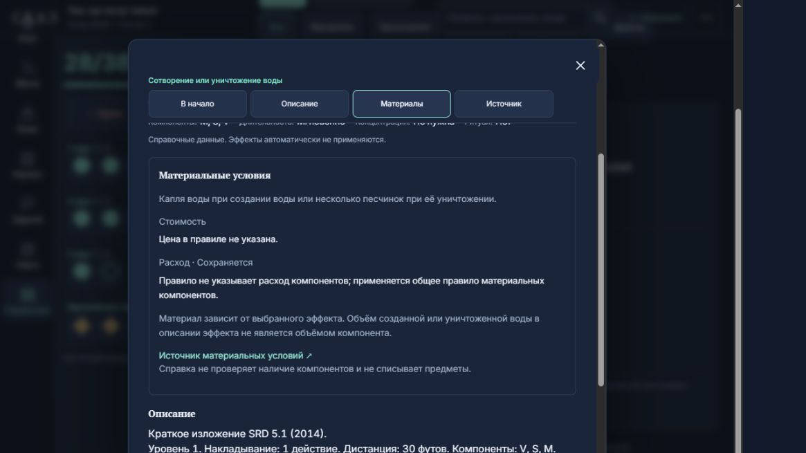

# Карточки: 42 справки о материалах — 19.11.2026

Refs #34. Выпущен 9715277: к прежним 12 справкам добавлено 30. Карточка показывает состав, условия, цену и расход; действие остаётся доступным. В частности, «Иллюзорное письмо» требует расходуемых чернил стоимостью не менее 10 зм, а «Сотворение или уничтожение воды» различает каплю воды и песок по выбранному эффекту. Личные версии не получают неподходящую справку автоматически. Сохранённые записи и схема не менялись.

Приняты PR121–124. Независимый read-only reviewer сверил старые и новые записи, закреплённый SHA и защиту личных версий. Его ревью не подменяет браузерные проверки автора. Промежуточная версия с 20 справками отдельно не выпускалась.

## Проверки

- Финальный Linux: 1578/1578, без пропусков и ошибок; check/build. Windows до финальной правки пробела: 1572 прошли, 6 POSIX-пропусков; после правки 20/20 профильных. Аудит источников 42/42.
- IAB, вымышленная игра на 127.0.0.1:4337: поиск, Материалы, Escape, доступные действия; Свет и Сообщение на узком экране, Иллюзорное письмо и условные компоненты воды. Исправлен пробел в заметке «Цена 10 зм». Три темы и ошибки/повтор подтверждены предыдущим PR117 с той же производственной вёрсткой.
- Android в свободном окне 00:25–00:29 МСК: финальные условия чернил на телефоне вертикально и планшете в обеих ориентациях. Альбомный телефон показал навигацию и заголовок; этот снимок не доказывает читаемость тела материалов. Физическая проверка Xiaomi продолжительностью не менее двух часов остаётся.
- После выпуска HTTPS, общий и личный вход, Secure-cookie, Origin, экспорт v13, точный вымышленный контекст; все 42 справки сверены по четырём страницам 319 заклинаний, два клиентских файла совпали. Проверочный сеанс отозван.

## Доказательства

[Android телефон](qa/spell-material-fortytwo-2026-11-19/ink-phone.png), [планшет горизонтально](qa/spell-material-fortytwo-2026-11-19/ink-tablet-landscape.png), [планшет вертикально](qa/spell-material-fortytwo-2026-11-19/ink-tablet-portrait.png).

## Остаток и передача

В приложении 42 справки. PR125–129 содержат ещё 62 независимо проверенные записи вне выпуска. Итого разобраны 104 из 184 M-заклинаний текущего SRD-каталога, остаются 80; это не полнота всего каталога 2014. Следующий шаг — интеграция 62 с обновлением SHA, unknown-примера и проверками API/UI; затем оставшиеся материалы 4–9 кругов. #34 и этапы не закрыты.

Рефлексия для планировщика: несколько небольших партий удобно сверять независимо, но выпускать их стоит одним проверенным пакетом. Это сокращает повторные сборки и резервирование; риск смешать готовые и ожидающие данные снижается фиксацией точного commit выпуска. Общие инструкции не менялись.
